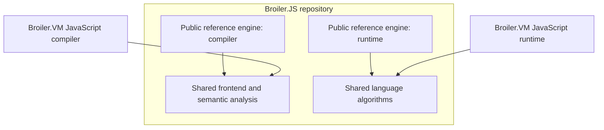

# Shared JavaScript libraries: feasibility report

Date: 2026-10-11

Repositories examined: `D:\Broiler.VM` and `D:\Broiler.JS`.

## Assessment

**Yes.** Broiler.JS can become the home of reusable JavaScript libraries, with its current engine remaining an independently usable public reference implementation built on those libraries. The most promising outcome is shared language processing and algorithms, with each engine retaining its own execution machinery.

The purpose is to reduce duplicated language logic and maintenance complexity across Broiler.VM.Profile.JavaScript and Broiler.JS. The investigation also covers the VM profile's compiler, format and internationalization siblings, because relevant responsibilities span those projects.

This is a source-level feasibility assessment. No implementation changes, builds, tests or performance measurements were performed for the assessment. The findings establish overlapping responsibilities; they do not prove that the implementations behave identically. Proposed boundaries and migration steps below are recommendations, not completed or validated architecture changes.

Links are relative to this report and assume the two repositories are sibling checkouts. Source references describe the inspected working trees and are not pinned to commit hashes.

## Existing foundations

Broiler.JS already separates its parser, AST, runtime, compiler, built-ins and distribution packages. Its limited portable bytecode compiler reuses `FastParser` and the AST, demonstrating that these components can serve another backend. Its architecture document also proposes a shared frontend containing binding, scope analysis, early errors and hoisting. That proposed separation is not yet complete.

Evidence:

- [Portable compiler](../../Broiler.JS/Broiler.JS/Broiler.JavaScript.Portable.Compiler/PortableCompiler.cs): `Compile` reuses `FastParser` and then applies the portable backend's admission rules.
- [Broiler.JS dependency design](../../Broiler.JS/docs/architecture/dependencies.md): the proposed `FrontEnd/Semantics` boundary references neither backend.

Broiler.VM separately implements tokenization, parsing, syntax trees, JavaScript semantics and standard-library algorithms. There are therefore substantial areas where one maintained implementation could serve both engines.

## Extraction candidates

| Area | Assessment | Recommended boundary |
| --- | --- | --- |
| Number parsing and formatting | Strong first candidate | Primitive inputs and outputs: strings, spans, numbers and explicit options. |
| Date and calendar arithmetic | Strong candidate | Epoch calculations, leap years, component calculations and clipping; engine wrappers retain coercion and clock access. |
| Temporal arithmetic and parsing | Promising, with additional separation work | Date/time records, exact arithmetic, rounding and parsed results; adapters create JavaScript values and exceptions. |
| Tokenizer, parser and AST | High potential benefit; substantial migration | A frontend independent of either runtime, with explicit parse context, source spans and diagnostics. |
| Static semantic analysis | High potential benefit; currently mixed into other stages | Declaration, scope, binding and early-error analysis; backend-specific storage allocation and emission remain separate. |
| Unicode, locale and time-zone data | Promising, but behavior and data versions differ | Versioned data providers and algorithms, preserving optional deployment. |
| Regular expressions | Possible, but a separate consolidation project | Pattern compilation and matching with explicit resource controls; engine-specific RegExp objects remain separate. |
| Test vectors and conformance fixtures | Useful immediately | Shared language expectations, with separate adapters and engine-specific tests. |

### Number conversion: the clearest first experiment

VM's `JsNumberFormat` already operates on ordinary CLR values and uses only `System` dependencies. Broiler.JS implements equivalent responsibilities in `NumberParser` and methods inside `JSNumber`. For example, VM has `ToJsString(double)` while Broiler.JS has `ToECMAString(double)`. These are natural candidates for one shared implementation without sharing either engine's value objects.

Evidence:

- [VM number formatting](../src/Broiler.VM.Profile.JavaScript/JsNumberFormat.cs).
- [Broiler.JS number formatting](../../Broiler.JS/Broiler.JS/Broiler.JavaScript.BuiltIns/Number/JSNumber.cs).
- [Broiler.JS number parsing](../../Broiler.JS/Broiler.JS/Broiler.JavaScript.Runtime/NumberParser.cs).

The algorithms are not identical today, so extraction should start with a common test corpus. Negative zero, rounding, exponent notation, radix conversion and unusually large inputs are examples where apparently equivalent implementations can disagree. Neutral `string` or `ReadOnlySpan<char>` inputs would also avoid importing Broiler.JS's AST-owned `StringSpan` into an otherwise independent numeric library.

### Frontend: a larger long-term opportunity

A shared frontend could produce syntax trees, diagnostics and semantic information for both the Broiler.JS compiler and the VM compiler.

Directly referencing the existing Broiler.JS parser would be premature:

- Its project currently references Broiler.JS Runtime, and parsing reads some options through ambient `CoreScript` state.
- Early-error checks are distributed between parsing and compilation.
- Some AST information is mutable and adjusted during compilation.
- VM has separate slice and wide parsers, sharing a tokenizer but using different trees.
- VM carries explicit nesting limits, syntax-tree limits, feature admission and structured diagnostics.

These differences require a designed contract. The shared frontend should accept explicit options for script/module goals, strictness and inherited evaluation context. It should return language-level syntax and semantic facts. Each compiler should retain decisions about supported features, local slots, instructions and backend emission.

Evidence:

- [Current Broiler.JS parser references](../../Broiler.JS/Broiler.JS/Broiler.JavaScript.Parser/Broiler.JavaScript.Parser.csproj).
- [VM parse options](../src/Broiler.VM.Profile.JavaScript.Compiler/SliceParseOptions.cs).
- [VM wide syntax tree](../src/Broiler.VM.Profile.JavaScript.Compiler/JsSyntax.cs).
- [VM hoisting implementation](../src/Broiler.VM.Profile.JavaScript.Compiler/JsCompiler.Hoisting.cs), where declaration analysis and instruction emission currently coexist.

## Responsibilities to keep engine-specific initially

The value model, object model and execution backend should remain separate initially. This is the strongest limitation on how far straightforward sharing can go.

Broiler.JS represents values through a public `JSValue` class hierarchy, with factories, dynamic-expression integration and runtime callbacks. VM uses an internal tagged `JsValue` struct. Their object storage and optimization strategies also differ.

Evidence:

- [Broiler.JS values](../../Broiler.JS/Broiler.JS/Broiler.JavaScript.Runtime/JSValue.cs).
- [VM values](../src/Broiler.VM.Profile.JavaScript/JsValue.cs).
- [Broiler.JS object storage](../../Broiler.JS/Broiler.JS/Broiler.JavaScript.Runtime/JSObject.cs).
- [VM object storage](../src/Broiler.VM.Profile.JavaScript/JsObject.cs).

A universal value interface would affect allocation, dispatch, identity, exceptions and performance. It would not automatically make the existing built-ins reusable. Sharing complete implementations of Array, Promise, Proxy or object-property operations would require a much larger runtime design effort.

Initially, each engine should retain:

- Its value representation, object storage, frames and execution loop.
- Its backend-specific compiler and emitted formats.
- Its host integration, realm lifecycle and capability policy.
- Its JavaScript object construction, coercion and exception translation.
- For VM: verification, resource budgets, cancellation and continuation handling.

## Proposed dependency structure

Begin with a few logical boundaries rather than creating a package for every feature. The following shows selected dependencies; arrows mean “depends on.” These are proposed logical boundaries, not final package names or a complete project graph.

Optional internationalization data could remain separately packaged. The shared libraries should have no dependency on either concrete engine or the VM core.

This arrangement preserves VM's existing ability to deploy an execution-only composition without a compiler: the VM compiler consumes the shared frontend, while the VM runtime consumes only the algorithms it needs. Shared runtime helper packages must not transitively introduce parsing, IL generation, CLR integration or global built-in initialization.

## Important compatibility considerations

### Unicode and data versions

Unicode normalization is a concrete example of apparent duplication requiring careful treatment: VM uses pinned Unicode tables, while Broiler.JS currently calls platform normalization in its string implementation. Consolidating these would change the source of behavior, potentially improving consistency, but it would require explicit compatibility testing.

Evidence:

- [VM normalization](../src/Broiler.VM.Profile.JavaScript/JsUnicodeNormalization.cs).
- [Broiler.JS string transformations](../../Broiler.JS/Broiler.JS/Broiler.JavaScript.BuiltIns/String/JSStringPrototype.Transform.cs).

Time-zone and locale consolidation likewise requires agreement on data versions, aliases, supported ranges and update policy. Equivalence of the current time-zone datasets was not established in this assessment. Optional data must remain optional for compositions that do not enable the corresponding features.

### Existing reusable packages

Broiler.JS already consumes standalone Regex and Unicode/CLDR packages. Before introducing another shared implementation inside Broiler.JS, those existing libraries should be evaluated as possible owners of common functionality. Repository consolidation should not create another version of an already reusable library.

See [Broiler.JS built-in dependencies](../../Broiler.JS/Broiler.JS/Broiler.JavaScript.BuiltIns/Broiler.JavaScript.BuiltIns.csproj).

### Observable coercion and exceptions

Some promising helpers still perform JavaScript coercion or create engine-specific exceptions. VM's Temporal parser accepts a `JsEngine`, while Broiler.JS's Temporal string helpers include `JSValue` coercion and runtime-created errors.

The reusable portion should return neutral records or error information. Engine adapters must preserve observable property-access order, coercion side effects, exception type and error timing.

See [VM Temporal parsing](../src/Broiler.VM.Profile.JavaScript/JsTemporalParser.cs) and [Broiler.JS Temporal string handling](../../Broiler.JS/Broiler.JS/Broiler.JavaScript.BuiltIns/Temporal/TemporalIsoString.cs).

### Resource accounting and cancellation

A shared algorithm that computes the correct result but removes VM's work checkpoints would be a regression. VM's BigInt implementation already demonstrates a useful pattern: arithmetic receives a charging callback without depending directly on the engine. Similar narrow contracts can preserve cancellation and bounded work where necessary.

See [BigInt work accounting](../src/Broiler.VM.Profile.JavaScript/JsBigInt.cs), particularly `ToDecimalString(Action<ulong> charge)` and the comments explaining engine-independent arithmetic.

## Architecture and packaging changes

VM currently rejects external project references, Broiler package dependencies and externally linked source files. Its profile rules also constrain the permitted reference set. Broiler.JS's architecture documentation explicitly describes the repositories as independent. These are current design decisions, rather than technical impossibilities.

Relevant records and enforcement:

- [VM architecture rules](../src/tests/Broiler.VM.Architecture.Tests/ArchitectureRules.cs): A1, A2 and A3, plus the JavaScript profile reference rules.
- [VM project graph manifest](../src/tests/Broiler.VM.Architecture.Tests/graph.manifest.json).
- [VM topology decision](adr/0001-component-topology-and-dependency-graph.md).
- [Broiler.JS dependency design](../../Broiler.JS/docs/architecture/dependencies.md).

The migration should replace the current restrictions with narrowly defined permitted dependencies on shared libraries. Update the documented architecture, manifests, rule implementations and negative tests together. Preserve the VM core's independence from JavaScript and continue rejecting dependencies on the full Broiler.JS engine.

Versioned packages would provide a clearer cross-repository contract than copying or linking source files. Reproducible builds and clean package-consumer checks should verify the intended dependency closure.

## Preserving the public Broiler.JS implementation

The current public Broiler.JS engine can remain usable throughout. Its `All` and `Minimal` packages already serve as compositions of smaller packages, fitting the proposed reference-engine role.

Existing embedding APIs and entry points can remain in place while internal implementations gradually delegate to shared libraries. Moving public types between assemblies would need a separate compatibility decision; calling the engine a “sample” should not silently change its public contract.

Evidence:

- [All distribution package](../../Broiler.JS/Broiler.JS/Broiler.JavaScript.All/Broiler.JavaScript.All.csproj).
- [Minimal embedding package](../../Broiler.JS/Broiler.JS/Broiler.JavaScript.Minimal/Broiler.JavaScript.Minimal.csproj).
- [Existing extraction guidance](../../Broiler.JS/docs/architecture/extraction-pattern.md).

## Recommended migration order

1. **Define the intended dependencies and capture baselines.** Record public APIs, supported feature configurations, conformance results, package contents and relevant performance measurements.
2. **Pilot numeric formatting.** Introduce one small shared implementation, consume it from both engines, compare results and remove the replaced duplicate code.
3. **Extract selected arithmetic and data helpers.** Date/calendar calculations and suitable Temporal routines are reasonable next candidates. Preserve coercion and error behavior in engine adapters.
4. **Design and migrate the shared frontend.** Make parse context explicit, identify all early-error responsibilities, then select a canonical syntax representation. Temporary AST adapters can make this incremental. Account for both VM frontend paths.
5. **Evaluate larger areas individually.** RegExp, internationalization and additional semantic algorithms should proceed only where the shared implementation reduces total complexity. Whole-runtime unification can remain a separate decision.

Each step should demonstrate both preserved behavior and actual removal of duplicated responsibility. Otherwise, the result risks adding another abstraction layer while retaining both original implementations.

## Validation

VM already has a differential harness that can run probes against Broiler.JS. This provides a practical starting point for comparing migrated behavior. Agreement between the engines is useful, but shared code also means shared bugs, so specification-based tests and Test262 remain necessary.

See the [existing comparison harness documentation](../src/tests/differential/README.md).

Relevant migration checks include:

- Shared algorithm vectors and each engine's integration/conformance tests.
- Invalid-source diagnostics, script/module goals, strictness, eval context and feature admission.
- Coercion side effects, property-access order, exception behavior and realm isolation.
- Resource exhaustion, cancellation and large-input behavior.
- Public APIs and pristine package consumers.
- VM architecture rules, verifier behavior and compiler-free execution-only deployment.
- Trimming and NativeAOT publish/run checks for the intended compositions.
- Focused measurements of allocations, execution speed, parsing, startup and deployed size.

Tests and measurements should be selected for the area being migrated. A dependency graph free of IL emission alone does not prove that a complete engine is NativeAOT-compatible.

## Expected benefit and limits

The expected benefit is a meaningful reduction in duplicated language logic and maintenance effort, especially after frontend consolidation. Language fixes could be implemented once and exercised through both engines, while each engine retains its specialized execution strategy.

No percentage reduction or delivery estimate is justified by this inspection. ECMAScript's inherent complexity remains, and new shared API and package-version responsibilities are introduced. File moves or additional interfaces alone do not demonstrate simplification.

**The first milestone should prove that one small shared algorithm makes both engines simpler. Broader extraction should follow that demonstrated pattern.**
