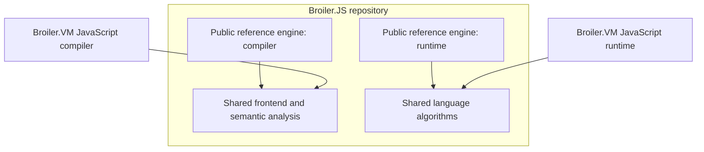

# Shared JavaScript libraries: feasibility report

Date: 2026-10-11

Repositories examined: `D:\Broiler.VM` and `D:\Broiler.JS`.

> **Reviewed 2026-10-11. This report is an assessment, not a plan.**
>
> - **The plan** that turns it into milestones `SJL-0` to `SJL-17` is in
>   [`docs/javascript-shared-libraries/`](javascript-shared-libraries/README.md). That directory
>   holds the [roadmap](javascript-shared-libraries/roadmap.md), the
>   [ledger](javascript-shared-libraries/status.md), the
>   [decision points](javascript-shared-libraries/decisions.md), the target
>   [architecture](javascript-shared-libraries/architecture.md), the per-area designs, and the
>   [claim-by-claim review](javascript-shared-libraries/review.md).
> - **The review confirms this report's direction.** Its findings are noted below in dated italic
>   notes. The original text is kept unchanged beside them.
> - **Every decision point was taken later on 2026-10-11.** The notes below cite decisions by
>   number, as they stood when the review wrote them; the
>   [decision register](javascript-shared-libraries/decisions.md) records each choice and where it
>   is recorded. The time-critical item is now the record of `SJL-D-7`, due before 2026-11-30.
> - **The review also examined** Broiler.Unicode, Broiler.RegEx, Broiler.DateTime and Broiler.JSeal,
>   which this report did not.
> - **"Recommended migration order" is superseded** by the roadmap's delivery order. It is kept as
>   the assessment's own view.

## Assessment

**Yes.** Broiler.JS can become the home of reusable JavaScript libraries, with its current engine remaining an independently usable public reference implementation built on those libraries. The most promising outcome is shared language processing and algorithms, with each engine retaining its own execution machinery.

The purpose is to reduce duplicated language logic and maintenance complexity across Broiler.VM.Profile.JavaScript and Broiler.JS. The investigation also covers the VM profile's compiler, format and internationalization siblings, because relevant responsibilities span those projects.

This is a source-level feasibility assessment. No implementation changes, builds, tests or performance measurements were performed for the assessment. The findings establish overlapping responsibilities; they do not prove that the implementations behave identically. Proposed boundaries and migration steps below are recommendations, not completed or validated architecture changes.

Links are relative to this report and assume the two repositories are sibling checkouts. Source references describe the inspected working trees and are not pinned to commit hashes.

## Existing foundations

Broiler.JS already separates its parser, AST, runtime, compiler, built-ins and distribution packages. Its limited portable bytecode compiler reuses `FastParser` and the AST, demonstrating that these components can serve another backend. Its architecture document also proposes a shared frontend containing binding, scope analysis, early errors and hoisting. That proposed separation is not yet complete.

Evidence:

- [Portable compiler](../../Broiler.JS/Broiler.JS/Broiler.JavaScript.Portable.Compiler/PortableCompiler.cs): `Compile` reuses `FastParser` and then applies the portable backend's admission rules.
- [Broiler.JS dependency design](../../Broiler.JS/docs/architecture/dependencies.md): the proposed `FrontEnd/Semantics` boundary references neither backend.

*(Noted 2026-10-11 by the review. The proposed `FrontEnd/Semantics` boundary is to be shared
between **Broiler.JS's own** IL and portable back ends. It is a hypothesis pending Broiler.JS's
MOD-M2 work, and it has not started. The same document states that "nothing here plans an
integration" with Broiler.VM, and Broiler.JS's `public-api.md` says "No Broiler.VM integration is
planned for this component, and none changes that statement". Other Broiler.JS roadmap documents
still plan one. Both records are revised at SJL-0. The portable compiler parses outside any ambient
goal scope, so always as a script, and runs no early-error validation.)*

Broiler.VM separately implements tokenization, parsing, syntax trees, JavaScript semantics and standard-library algorithms. There are therefore substantial areas where one maintained implementation could serve both engines.

*(Noted 2026-10-11 by the review. Broiler.VM's front ends were written in its own checkout. Its
JavaScript profile had planned to start from a **snapshot copy** of Broiler.JS (milestone JS-2),
which was never taken. Profile decision JSD-0005 takes that copy by default on 2026-11-30, so
re-scoping JS-2 is the programme's one time-critical decision, `SJL-D-7`.)*

## Extraction candidates

| Area | Assessment | Recommended boundary |
| --- | --- | --- |
| Number parsing and formatting | Strong first candidate | Primitive inputs and outputs: strings, spans, numbers and explicit options. |
| Date and calendar arithmetic | Strong candidate | Epoch calculations, leap years, component calculations and clipping; engine wrappers retain coercion and clock access. |
| Temporal arithmetic and parsing | Promising, with additional separation work | Date/time records, exact arithmetic, rounding and parsed results; adapters create JavaScript values and exceptions. |
| Tokenizer, parser and AST | High potential benefit; substantial migration | A frontend independent of either runtime, with explicit parse context, source spans and diagnostics. |
| Static semantic analysis | High potential benefit; currently mixed into other stages | Declaration, scope, binding and early-error analysis; backend-specific storage allocation and emission remain separate. |
| Unicode, locale and time-zone data | Promising, but behavior and data versions differ | Versioned data providers and algorithms, preserving optional deployment. |
| Regular expressions | Possible, but a separate consolidation project | Pattern compilation and matching with explicit resource controls; engine-specific RegExp objects remain separate. |
| Test vectors and conformance fixtures | Useful immediately | Shared language expectations, with separate adapters and engine-specific tests. |

*(Noted 2026-10-11 by the review.)*

- **Areas the table omits:**
  - BigInt, Math kernels and Float16;
  - exact rounding, used by both Temporal and Intl;
  - the text algorithms: URI, base64 and hex, JSON lexing, substitution templates;
  - the Intl *algorithms*, as distinct from Intl *data*;
  - the duplication inside each engine. Broiler.VM's compiler carries its own copies of number
    rendering, BigInt parsing and JSON reading, and Broiler.JS converts numbers in its parser,
    runtime and built-ins.
- **Existing owners for two rows.** The regular-expression and Unicode rows have published owners
  outside Broiler.JS: Broiler.Regex, and Broiler.Unicode with its CLDR package. Both already serve
  Broiler.JS.

See [the inventory](javascript-shared-libraries/inventory.md).

### Number conversion: the clearest first experiment

VM's `JsNumberFormat` already operates on ordinary CLR values and uses only `System` dependencies. Broiler.JS implements equivalent responsibilities in `NumberParser` and methods inside `JSNumber`. For example, VM has `ToJsString(double)` while Broiler.JS has `ToECMAString(double)`. These are natural candidates for one shared implementation without sharing either engine's value objects.

Evidence:

- [VM number formatting](../src/Broiler.VM.Profile.JavaScript/JsNumberFormat.cs).
- [Broiler.JS number formatting](../../Broiler.JS/Broiler.JS/Broiler.JavaScript.BuiltIns/Number/JSNumber.cs).
- [Broiler.JS number parsing](../../Broiler.JS/Broiler.JS/Broiler.JavaScript.Runtime/NumberParser.cs).

The algorithms are not identical today, so extraction should start with a common test corpus. Negative zero, rounding, exponent notation, radix conversion and unusually large inputs are examples where apparently equivalent implementations can disagree. Neutral `string` or `ReadOnlySpan<char>` inputs would also avoid importing Broiler.JS's AST-owned `StringSpan` into an otherwise independent numeric library.

*(Noted 2026-10-11 by the review: the claims hold, with these qualifications.)*

- **Broiler.VM's `JsNumberFormat`** is `internal`, so the compiler duplicates it as
  `JsParser.NumberText`.
- **`toFixed`, `toExponential` and `toPrecision`** are private statics of `JsRealm.Number`, not
  members of `JsNumberFormat`.
- **Its results depend on the runtime:** on .NET's `"R"` format, and on the runtime's Unicode data
  for the `Zs` category.
- **Broiler.JS spreads the responsibility further.** Besides `NumberParser` and `JSNumber`, it uses
  `JSNumberPrototype`, the parser's own `NumberCoercion`, two `parseInt`/`parseFloat` wrapper pairs,
  a delegate seam (`JSValue.NumberToECMAString`), and several whitespace sets.
- **Reading the code suggests defects in both engines.** These are to be confirmed by vectors:
  - Broiler.VM rounds `parseInt` and long hexadecimal strings twice;
  - Broiler.JS mishandles radix `0` and `null`, the argument order of `toPrecision`, and the
    whitespace set.

See [areas/numbers.md](javascript-shared-libraries/areas/numbers.md).

### Frontend: a larger long-term opportunity

A shared frontend could produce syntax trees, diagnostics and semantic information for both the Broiler.JS compiler and the VM compiler.

Directly referencing the existing Broiler.JS parser would be premature:

- Its project currently references Broiler.JS Runtime, and parsing reads some options through ambient `CoreScript` state.
- Early-error checks are distributed between parsing and compilation.
- Some AST information is mutable and adjusted during compilation.
- VM has separate slice and wide parsers, sharing a tokenizer but using different trees.
- VM carries explicit nesting limits, syntax-tree limits, feature admission and structured diagnostics.

These differences require a designed contract. The shared frontend should accept explicit options for script/module goals, strictness and inherited evaluation context. It should return language-level syntax and semantic facts. Each compiler should retain decisions about supported features, local slots, instructions and backend emission.

*(Noted 2026-10-11 by the review.)*

- **Broiler.JS's parser** uses exactly three `Runtime` types. It also names desugaring temporaries
  from a process-wide static counter, writes a shared static end-of-file token on every parse, and
  desugars `for` loops while it parses.
- **Broiler.VM's wide path also splits early errors**, between its parser and its lowering. Its
  hoisting order relies on dictionary insertion order.
- **Broiler.VM's decision JSD-0014 already rejects** split early errors and ambient parse state.
- **Broiler.VM's rules N12 and N19** (no ambient state; a tree-depth bound the host cannot raise)
  bind the contract.

See [areas/frontend.md](javascript-shared-libraries/areas/frontend.md).

Evidence:

- [Current Broiler.JS parser references](../../Broiler.JS/Broiler.JS/Broiler.JavaScript.Parser/Broiler.JavaScript.Parser.csproj).
- [VM parse options](../src/Broiler.VM.Profile.JavaScript.Compiler/SliceParseOptions.cs).
- [VM wide syntax tree](../src/Broiler.VM.Profile.JavaScript.Compiler/JsSyntax.cs).
- [VM hoisting implementation](../src/Broiler.VM.Profile.JavaScript.Compiler/JsCompiler.Hoisting.cs), where declaration analysis and instruction emission currently coexist.

## Responsibilities to keep engine-specific initially

The value model, object model and execution backend should remain separate initially. This is the strongest limitation on how far straightforward sharing can go.

Broiler.JS represents values through a public `JSValue` class hierarchy, with factories, dynamic-expression integration and runtime callbacks. VM uses an internal tagged `JsValue` struct. Their object storage and optimization strategies also differ.

Evidence:

- [Broiler.JS values](../../Broiler.JS/Broiler.JS/Broiler.JavaScript.Runtime/JSValue.cs).
- [VM values](../src/Broiler.VM.Profile.JavaScript/JsValue.cs).
- [Broiler.JS object storage](../../Broiler.JS/Broiler.JS/Broiler.JavaScript.Runtime/JSObject.cs).
- [VM object storage](../src/Broiler.VM.Profile.JavaScript/JsObject.cs).

A universal value interface would affect allocation, dispatch, identity, exceptions and performance. It would not automatically make the existing built-ins reusable. Sharing complete implementations of Array, Promise, Proxy or object-property operations would require a much larger runtime design effort.

Initially, each engine should retain:

- Its value representation, object storage, frames and execution loop.
- Its backend-specific compiler and emitted formats.
- Its host integration, realm lifecycle and capability policy.
- Its JavaScript object construction, coercion and exception translation.
- For VM: verification, resource budgets, cancellation and continuation handling.

## Proposed dependency structure

Begin with a few logical boundaries rather than creating a package for every feature. The following shows selected dependencies; arrows mean “depends on.” These are proposed logical boundaries, not final package names or a complete project graph.

Optional internationalization data could remain separately packaged. The shared libraries should have no dependency on either concrete engine or the VM core.

This arrangement preserves VM's existing ability to deploy an execution-only composition without a compiler: the VM compiler consumes the shared frontend, while the VM runtime consumes only the algorithms it needs. Shared runtime helper packages must not transitively introduce parsing, IL generation, CLR integration or global built-in initialization.

## Important compatibility considerations

### Unicode and data versions

Unicode normalization is a concrete example of apparent duplication requiring careful treatment: VM uses pinned Unicode tables, while Broiler.JS currently calls platform normalization in its string implementation. Consolidating these would change the source of behavior, potentially improving consistency, but it would require explicit compatibility testing.

Evidence:

- [VM normalization](../src/Broiler.VM.Profile.JavaScript/JsUnicodeNormalization.cs).
- [Broiler.JS string transformations](../../Broiler.JS/Broiler.JS/Broiler.JavaScript.BuiltIns/String/JSStringPrototype.Transform.cs).

Time-zone and locale consolidation likewise requires agreement on data versions, aliases, supported ranges and update policy. Equivalence of the current time-zone datasets was not established in this assessment. Optional data must remain optional for compositions that do not enable the corresponding features.

*(Noted 2026-10-11 by the review: the review established that the datasets are **not**
equivalent.)*

| | Broiler.VM | Broiler.JS |
|---|---|---|
| Release | 2026e | 2025b |
| How the data is produced | Pinned and compiled in the repository | Copied from a build host, unpinned |
| Backzone | Excluded | Mostly included |
| After the last listed transition | Extrapolated by recurring rules | Last offset frozen, wrong after 2037 |
| Primary identifiers | From CLDR | From tz link targets |

Optionality differs too. Broiler.VM's data is optional at deployment, through its separate `.Intl`
assembly; Broiler.JS's ships always.

See [areas/time-zones-and-calendars.md](javascript-shared-libraries/areas/time-zones-and-calendars.md).

### Existing reusable packages

Broiler.JS already consumes standalone Regex and Unicode/CLDR packages. Before introducing another shared implementation inside Broiler.JS, those existing libraries should be evaluated as possible owners of common functionality. Repository consolidation should not create another version of an already reusable library.

See [Broiler.JS built-in dependencies](../../Broiler.JS/Broiler.JS/Broiler.JavaScript.BuiltIns/Broiler.JavaScript.BuiltIns.csproj).

*(Noted 2026-10-11 by the review.)*

- **Broiler.Regex handles only part of the load.** Broiler.JS uses it only for `u`- and `v`-flag
  patterns and a few gap shapes. A .NET translator handles every other pattern.
- **The Unicode packages arrive only transitively.** `Broiler.Unicode.Properties` and its emoji
  package come in through Broiler.Regex, although Broiler.JS calls them directly.
- **Broiler.DateTime exists but is unused.** It was dropped by Broiler.JS on 2026-09-18 and has no
  consumer.
- **Broiler.VM has already evaluated these components and declined them.** JSD-0031 §4(b) declined
  `Broiler.Unicode.Properties` for five reasons, and JSD-0027 §4 recorded the CLDR package as
  "Candidate input, not accepted". The programme revisits both decisions on evidence (SJL-7, SJL-9).
- **Broiler.JSeal constrains package names.** It is an engine abstraction layer above both engines,
  and its package gate forbids either engine's package family in the other's graph
  (`SJL-D-2`).

### Observable coercion and exceptions

Some promising helpers still perform JavaScript coercion or create engine-specific exceptions. VM's Temporal parser accepts a `JsEngine`, while Broiler.JS's Temporal string helpers include `JSValue` coercion and runtime-created errors.

The reusable portion should return neutral records or error information. Engine adapters must preserve observable property-access order, coercion side effects, exception type and error timing.

See [VM Temporal parsing](../src/Broiler.VM.Profile.JavaScript/JsTemporalParser.cs) and [Broiler.JS Temporal string handling](../../Broiler.JS/Broiler.JS/Broiler.JavaScript.BuiltIns/Temporal/TemporalIsoString.cs).

*(Noted 2026-10-11 by the review. Broiler.VM's parser uses its engine argument **only** to construct
`RangeError`s. Its input is a string and its output a neutral record, so the separation is
mechanical. `TemporalIsoString` is not Broiler.JS's real parser: each Temporal type has its own
private regular-expression parser that returns engine objects and throws, and one of them reads
options part-way through parsing.)*

### Resource accounting and cancellation

A shared algorithm that computes the correct result but removes VM's work checkpoints would be a regression. VM's BigInt implementation already demonstrates a useful pattern: arithmetic receives a charging callback without depending directly on the engine. Similar narrow contracts can preserve cancellation and bounded work where necessary.

See [BigInt work accounting](../src/Broiler.VM.Profile.JavaScript/JsBigInt.cs), particularly `ToDecimalString(Action<ulong> charge)` and the comments explaining engine-independent arithmetic.

## Architecture and packaging changes

VM currently rejects external project references, Broiler package dependencies and externally linked source files. Its profile rules also constrain the permitted reference set. Broiler.JS's architecture documentation explicitly describes the repositories as independent. These are current design decisions, rather than technical impossibilities.

Relevant records and enforcement:

- [VM architecture rules](../src/tests/Broiler.VM.Architecture.Tests/ArchitectureRules.cs): A1, A2 and A3, plus the JavaScript profile reference rules.
- [VM project graph manifest](../src/tests/Broiler.VM.Architecture.Tests/graph.manifest.json).
- [VM topology decision](adr/0001-component-topology-and-dependency-graph.md).
- [Broiler.JS dependency design](../../Broiler.JS/docs/architecture/dependencies.md).

The migration should replace the current restrictions with narrowly defined permitted dependencies on shared libraries. Update the documented architecture, manifests, rule implementations and negative tests together. Preserve the VM core's independence from JavaScript and continue rejecting dependencies on the full Broiler.JS engine.

*(Noted 2026-10-11 by the review: the list of affected rules is incomplete.)*

- **Rules that fail.** A2, and N1, which refuses **any** package reference in the profile, fail
  immediately. K4, N37 and the pristine consumer's restore fail at the next evidence collection.
- **Rules that would pass silently.** B3, B4, B5, B5b, B5c, K5, J1 to J12, N12, N18, N19 and N23 scan
  only Broiler.VM's own sources and binaries, so code moved into a package would escape them.
- **Rules that lose their subjects.** The data-pin rules N22, N27, N28 and N29 to N32. (Under
  `SJL-D-6` (c), taken later that day, they keep them: Broiler.VM keeps its embedded tables.)
- **Rules that cannot express the change.** The graph manifest has no package edges.
- **Governing text beyond the rules.** The governing text includes:
  - roadmap sections 5, 9, 12, 14, 15 and 16;
  - the JavaScript profile's invariant 11;
  - **ADR 0011's standing refusals.** This is a contract-bearing record whose amendment procedure is
    unexecutable today (EX-15), which is why the programme takes a scope reading (`SJL-D-8`).

See [governance.md](javascript-shared-libraries/governance.md).

Versioned packages would provide a clearer cross-repository contract than copying or linking source files. Reproducible builds and clean package-consumer checks should verify the intended dependency closure.

*(Noted 2026-10-11 by the review: three facts shape the packaging.)*

- **One feed.** Both repositories restore from nuget.org only.
- **One version per process.** A process hosting both engines resolves **one** version of each
  shared package. Examples are Broiler.JSeal's tests and Broiler.HtmlBridge. Binary compatibility is
  therefore mandatory, and data-version drift is a real hazard (`SJL-D-3`, `SJL-D-6`).
- **One version per repository.** Broiler.JS's packing gives every package one version, so shared
  packages need their own version stream.

## Preserving the public Broiler.JS implementation

The current public Broiler.JS engine can remain usable throughout. Its `All` and `Minimal` packages already serve as compositions of smaller packages, fitting the proposed reference-engine role.

Existing embedding APIs and entry points can remain in place while internal implementations gradually delegate to shared libraries. Moving public types between assemblies would need a separate compatibility decision; calling the engine a “sample” should not silently change its public contract.

Evidence:

- [All distribution package](../../Broiler.JS/Broiler.JS/Broiler.JavaScript.All/Broiler.JavaScript.All.csproj).
- [Minimal embedding package](../../Broiler.JS/Broiler.JS/Broiler.JavaScript.Minimal/Broiler.JavaScript.Minimal.csproj).
- [Existing extraction guidance](../../Broiler.JS/docs/architecture/extraction-pattern.md).

## Recommended migration order

*(Superseded 2026-10-11 as a plan by the roadmap's
[delivery order](javascript-shared-libraries/roadmap.md#4-the-delivery-order-and-the-critical-path).)*
The roadmap keeps these five steps and adds what the review found:

- the records to revise, and the decisions to record, before anything else (SJL-0);
- a vector corpus before any shared code (SJL-1);
- an admission path with rules and witnesses (SJL-2);
- existing component owners for Unicode and regular expressions;
- an extraction gate applied to every area.

1. **Define the intended dependencies and capture baselines.** Record public APIs, supported feature configurations, conformance results, package contents and relevant performance measurements.
2. **Pilot numeric formatting.** Introduce one small shared implementation, consume it from both engines, compare results and remove the replaced duplicate code.
3. **Extract selected arithmetic and data helpers.** Date/calendar calculations and suitable Temporal routines are reasonable next candidates. Preserve coercion and error behavior in engine adapters.
4. **Design and migrate the shared frontend.** Make parse context explicit, identify all early-error responsibilities, then select a canonical syntax representation. Temporary AST adapters can make this incremental. Account for both VM frontend paths.
5. **Evaluate larger areas individually.** RegExp, internationalization and additional semantic algorithms should proceed only where the shared implementation reduces total complexity. Whole-runtime unification can remain a separate decision.

Each step should demonstrate both preserved behavior and actual removal of duplicated responsibility. Otherwise, the result risks adding another abstraction layer while retaining both original implementations.

## Validation

VM already has a differential harness that can run probes against Broiler.JS. This provides a practical starting point for comparing migrated behavior. Agreement between the engines is useful, but shared code also means shared bugs, so specification-based tests and Test262 remain necessary.

See the [existing comparison harness documentation](../src/tests/differential/README.md).

*(Noted 2026-10-11 by the review: the harness has limits as an oracle.)*

- **It cannot test an algorithm in isolation.** It runs whole programs in separate processes and
  compares their printed output, so algorithm-level comparison needs the shared vectors and the
  reference arms of [validation.md](javascript-shared-libraries/validation.md).
- **It is run by hand.** CI runs only its smoke fixtures, against Node.
- **Its Broiler.JS results are old and incomplete.** Its declarations are pinned to older
  Broiler.JS commits, and its last Broiler.JS run left findings unadjudicated.
- **The two engines' test262 runners pin the same revision,** but their totals are not comparable.

**Every performance measurement must compare one engine with itself.** Broiler.VM's JavaScript
profile forbids comparison "against any other engine or component, in either direction"
(release gate 10).

Relevant migration checks include:

- Shared algorithm vectors and each engine's integration/conformance tests.
- Invalid-source diagnostics, script/module goals, strictness, eval context and feature admission.
- Coercion side effects, property-access order, exception behavior and realm isolation.
- Resource exhaustion, cancellation and large-input behavior.
- Public APIs and pristine package consumers.
- VM architecture rules, verifier behavior and compiler-free execution-only deployment.
- Trimming and NativeAOT publish/run checks for the intended compositions.
- Focused measurements of allocations, execution speed, parsing, startup and deployed size.

Tests and measurements should be selected for the area being migrated. A dependency graph free of IL emission alone does not prove that a complete engine is NativeAOT-compatible.

## Expected benefit and limits

The expected benefit is a meaningful reduction in duplicated language logic and maintenance effort, especially after frontend consolidation. Language fixes could be implemented once and exercised through both engines, while each engine retains its specialized execution strategy.

No percentage reduction or delivery estimate is justified by this inspection. ECMAScript's inherent complexity remains, and new shared API and package-version responsibilities are introduced. File moves or additional interfaces alone do not demonstrate simplification.

**The first milestone should prove that one small shared algorithm makes both engines simpler. Broader extraction should follow that demonstrated pattern.**
