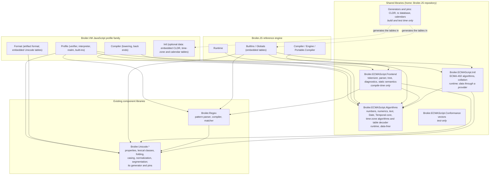

# Target architecture and contract conventions

**Date:** 2026-10-11. **Status:** planned target. Nothing described here exists yet unless it is
marked as existing today. The homes, the package names and their granularity follow decisions
`SJL-D-1` and `SJL-D-2`, and the shape of the data follows `SJL-D-6`, all taken on 2026-10-11
([decisions.md](decisions.md)). *(Revised 2026-10-11, when those decisions were taken. The status
read "proposed target", the package names were "working names", and the decisions were ones that
"nothing here takes".)*

This document describes the end state the programme aims at:

- which libraries exist;
- what each one holds;
- which engine projects reference them;
- which deployment boundaries they preserve;
- the conventions every shared API follows.

The per-area designs are in [areas/](areas/). The order in which the libraries come into being is
in [roadmap.md](roadmap.md).

---

## 1. The layering

Solid arrows mean **depends on**. Dashed arrows mean **generates the tables embedded in**: under
decision `SJL-D-6` (c) no package carries data an engine reads, so no composition depends on a data
package. Broiler.Unicode's generator does the same for the Unicode tables each engine embeds, which
the diagram leaves out for legibility.

*(Revised 2026-10-11, when decisions `SJL-D-1`, `SJL-D-6` and `SJL-D-22` were taken. The diagram drew
optional data packages, "Time-zone and calendar data" and `Broiler.Unicode.Cldr.LocaleData`, with
dashed dependency arrows from both engines' data assemblies.)*

*(Revised 2026-10-16, at SJL-7.1, by
[JSD-0074](../../src/Broiler.VM.Profile.JavaScript/docs/decisions/0074-unicode-moves-to-broiler-unicode-under-the-owner-conditions.md):
the arrow from Format to `Broiler.Unicode.*` is added. Format holds the property, lexical and folding lookups
that the compiler and the runtime both read, so it calls the owner's code; the diagram had drawn only the
profile's arrow.)*

**Only the data is optional, and that is deliberate.**

- **Broiler.VM** compiles its Intl and Temporal code into the profile assembly today. Only the
  *data* is optional: it lives in the separate `.Intl` assembly, read through the Format
  assembly's `IJsIntlData` boundary. The shared Intl library keeps exactly that shape: the profile
  references the code, and composition roots hand in the data.
- **Broiler.JS** ships its Intl and Temporal code and data in `BuiltIns` unconditionally today.
  Its own item A-2 (satellite assemblies for Intl, Temporal and RegExp) is the route by which
  Intl *code* could become optional there.

Making the Intl code optional in Broiler.VM too is a separate, later decision, and nothing here
depends on it.

Three properties of this picture are requirements, not observations:

1. **No shared library references either engine, and none references anything in Broiler.VM.**
   Broiler.VM's rule D1 refuses any inbound reference into the component. A shared library that
   needs a charging hook defines a neutral one rather than reusing `IVmMeter`.
2. **The runtime-side libraries contain no parser, no IL generation, no CLR integration and no
   global built-in initialization.** Broiler.VM's execution-only compositions hold a format, a
   verifier and an interpreter and no compiler at all. They may gain the algorithms, Unicode and
   regular-expression libraries, never the frontend. Rule `I3` (proposed) enforces this on the
   published closure.
3. **Optional data stays optional.** A composition that does not enable Intl or zoned Temporal
   carries no locale, time-zone or calendar data. Broiler.VM achieves this today with a separate
   `.Intl` assembly, read through the `IJsIntlData` boundary in the Format assembly and handed in by
   composition roots. That boundary is the model the shared data follows. Under decision `SJL-D-6`
   (c) the tables stay in that assembly, now generated by the shared generators.

---

## 2. The library catalogue

| Logical library | Package | Holds | Boundary | Home | May depend on |
|---|---|---|---|---|---|
| **Language algorithms** | `Broiler.ECMAScript.Algorithms` | Number-to-string and string-to-number conversion, radix, fixed, exponential and precision formatting, numeric literal values, integer conversions, Float16, Math kernels, the BigInt kernel with a width policy, whitespace and UTF-16 helpers, padding and index normalisation, substitution expansion, URI codecs, base64 and hex codecs, JSON lexing and quoting, Date arithmetic and the Date string grammar, the Temporal core (ISO records, balancing, duration arithmetic, rounding, the RFC 9557 grammar, the formula-defined calendars), exact rounding, the time-zone algorithms and the decoder of the time-data table format, and the provider interfaces that time-zone, calendar-table and local-time providers implement | Runtime; data-free apart from small sets the ECMAScript specification itself defines | Broiler.JS repository | The base class library only |
| **Intl algorithms** | `Broiler.ECMAScript.Intl` | ECMA-402 algorithms over a data provider: locale identifier parsing and canonicalisation, likely subtags, locale negotiation, the Intl mathematical value and number formatting, plural rules and plural ranges, date-time pattern generation and formatting, interval formatting, time-zone display names, list, relative-time, display-name and duration formatting cores, and UCA collation (SJL-17) | Runtime, with its **data** optional, which is today's shape in both engines (section 1) | Broiler.JS repository | Algorithms, Unicode; data through a provider interface |
| **Frontend** | `Broiler.ECMAScript.Frontend` | Tokenizer, parser, the canonical syntax tree, positions, diagnostics with stable codes, and static semantics: scopes, declarations, bindings, early errors, hoisting facts, label and jump targets, private-name environments, module records | **Compile time only** | Broiler.JS repository | Algorithms (literal values), Unicode (identifier classes), Regex (literal validation) |
| **Unicode character data and algorithms** | `Broiler.Unicode.Properties`, `Broiler.Unicode.Emoji.StringProperties` (exist), extended or joined by normalization, casing and segmentation packages | ECMAScript-exact property lookup, lexical classes, case folding and canonicalisation, default and language-sensitive case mapping, normalization, grapheme, word and sentence segmentation, properties of strings; the generator and pins that produce the tables each engine embeds | Runtime; segmentation is optional | Broiler.Unicode (exists), under SJL-7.1's conditions | Nothing |
| **Locale data** | **No package** while decision `SJL-D-6` (c) holds: the generator Broiler.VM uses today, with its pins, produces the tables each engine embeds. `Broiler.ECMAScript.IntlData` is the identity reserved for a later data package. | The CLDR tables ECMA-402 needs, in the provider format the Intl library reads, with a public CLDR version and pinned, hashed inputs | Optional, in each engine's data assembly | Broiler.JS repository (`SJL-D-1` (b-ii)) | Nothing |
| **Time data** | **No package** while `SJL-D-6` (c) holds: the generators and pins produce the tables each engine embeds. `Broiler.ECMAScript.TimeData` is the reserved identity. | IANA time-zone transitions, identifiers and the primary-identifier policy, plus the calendar tables that cannot be computed from a formula: Chinese, Korean, Umm al-Qura, Persian corrections | Optional, in each engine's data assembly | Broiler.JS repository (`SJL-D-1` (b-iii)) | Nothing; the decoder that implements the provider interfaces is in Algorithms |
| **Regular expressions** | `Broiler.Regex` (exists) | Pattern parser and early errors, compiler, matcher with a caller-owned work budget, flag parsing, `RegExp.escape` text helpers | Runtime; the parser is also used at compile time | Broiler.RegEx (exists), fixed to Broiler.VM's requirements (`SJL-D-14` (a)) | Unicode |
| **Conformance vectors** | `Broiler.ECMAScript.Conformance` | The shared vector corpus, its schema and small runner helpers | **Test only**; never in a product closure | Broiler.JS repository | Nothing |

**Why these boundaries and no others.** Broiler.VM's roadmap section 5 accepts a new assembly only
when it "must enforce a dependency, AOT, deployment, ownership, test, or package boundary", and the
feasibility report asks for "a few logical boundaries rather than … a package for every feature".
Each row above enforces exactly one boundary:

- the algorithms library, the runtime-without-compiler boundary;
- the Intl library, the boundary between the ECMA-262 core and ECMA-402. That boundary lets
  Broiler.JS's satellite plan, and later Broiler.VM, make Intl code optional without splitting a
  library;
- the frontend, the compile-time boundary;
- the data, the optional-deployment boundary, which each engine's own data assembly enforces while
  decision `SJL-D-6` (c) holds;
- the component libraries, an ownership boundary that already exists;
- the vectors, the test-only boundary.

Splitting the algorithms library into `Numerics`, `Text` and `Time` would enforce no boundary
these do not already enforce. That alternative, (b) of decision `SJL-D-2`, was not taken.

**Why a neutral package prefix.** Decision `SJL-D-2` explains the constraints. In short, three
things rule out the existing prefixes:

- Broiler.JSeal's package gate treats `Broiler.JavaScript.*` and `Broiler.VM.*` as engine families
  that neither provider may cross. A shared package named into either family and consumed by the
  other engine would fail it.
- Broiler.JS's `eng/pack.ps1` gives every package it packs one version.
- Broiler.VM's rule A2 tests the `Broiler.` prefix.

`Broiler.ECMAScript.*` is the prefix decision `SJL-D-2` took. No reservation of it on nuget.org is
required. *(Corrected 2026-10-12, when the owner withdrew the reservation and `SJL-D-2` was revised.
It read: "It is reserved on nuget.org before anything under it is published (SJL-2.13).")*

---

## 3. Which engine project references what

### 3.1 Broiler.VM

| Project | References after the programme (beyond the core and its own siblings) | Why |
|---|---|---|
| `Broiler.VM.Profile.JavaScript` (runtime) | Algorithms, Intl, Unicode, Regex | Built-ins call the algorithms. The `Intl` constructors call the Intl library over the data the composition handed in. `normalize`, casing and `RegExp` call the component libraries. |
| `Broiler.VM.Profile.JavaScript.Compiler` | Frontend, Algorithms *(Revised 2026-10-25, at SJL-11.1, by [JSD-0081](../../src/Broiler.VM.Profile.JavaScript/docs/decisions/0081-regular-expressions-move-to-broiler-regex-under-its-owner-conditions.md) decision D18: **and Regex, from SJL-11.4 until SJL-13**, for literal validation. The binder's `CheckRegExp` calls Broiler.Regex's validate entry, with the nesting limit and no meter, keeping this family's diagnostic code and the literal's span; that entry is the seam JSD-0080's decision D41 names, and from SJL-13 the frontend reaches Regex instead, as section 2's catalogue gives it. The cell read "Frontend, Algorithms".)* | The lowering consumes the frontend's validated tree and semantic facts; literal values come from the algorithms |
| `Broiler.VM.Profile.JavaScript.Format` | Nothing new | Today it holds the regular-expression matcher and the Unicode tables only because the compiler and the runtime may not reference each other and both need them. Once Broiler.Regex replaces the matcher (`SJL-D-14` (a)) and the Unicode lookups move to their owner, both projects reference the components directly. Format keeps the artifact format and the embedded Unicode tables both read, which the owner's generator produces (`SJL-D-6` (c)). |
| `Broiler.VM.Profile.JavaScript.Intl` | Nothing new | It stays the optional data assembly. Its CLDR, time-zone and calendar tables are produced by the generators in the Broiler.JS repository, and it hands them to the shared libraries through the provider interface that replaces `IJsIntlData` or adapts it. |
| Composition roots | Nothing directly | Rule A12 keeps roots free of package references; shared packages arrive transitively, and each root's register row in `docs/compositions.md` declares them |
| Core (`Abstractions`, `Binary`, `Runtime`), `Ubc`, emitters, the WebAssembly profile | **Nothing, ever** | The core owns no language semantics; rule `I1` (proposed) refuses a shared package anywhere outside the JavaScript family |

### 3.2 Broiler.JS

| Project | References after the programme | What it stops owning |
|---|---|---|
| `Broiler.JavaScript.Parser` | Replaced by the frontend (SJL-14); before that, Algorithms and Unicode | `NumberCoercion`, `CharExtensions` identifier classes, `RegExpValidator`, the ambient `CoreScript` reads, `FastParser`, `FastScanner`, `SyntaxValidation` |
| `Broiler.JavaScript.Runtime` | Algorithms | `NumberParser` internals, `UriHelper`, `RegExpUnicodeValidator`, the `JSValue.NumberToECMAString` delegate seam |
| `Broiler.JavaScript.BuiltIns` (and its future satellites, item A-2) | Algorithms, Intl, Unicode, Regex; it embeds the generated Unicode, locale, time-zone and calendar tables | Number formatting kernels, BigInt kernels, base64 and hex codecs, the .NET regular-expression translator, platform normalization, segmentation and casing, the embedded `tzdata.bin`, the copies of the civil-day and rounding helpers in each Temporal type, the per-type Temporal string parsers, and the host `CultureInfo`, `CompareInfo` and `TimeZoneInfo` paths of Intl and Date |
| `Broiler.JavaScript.Compiler`, `Engine`, `Portable.Compiler` | Frontend | Scope analysis, hoisting, early errors scattered across the parser and the compiler |
| `All`, `Minimal` | Unchanged as meta-packages; their closures gain the shared packages | Nothing |

Public types Broiler.JS ships today keep working, under decision `SJL-D-25`: forwarders for the
members downstream consumers or tests use, obsolete forwarders for the rest, and removal only after
a recorded consumer check. Examples are `NumberParser.CoerceToNumber`, `JSNumericOperators.ToInt32`
and `JSNumberPrototype.DecimalToBase`. The public `Ast` and `Parser` packages become adapter
packages and are removed in a later major version (decision `SJL-D-12` (i)). See
[governance.md](governance.md#5-release-versioning-and-compatibility) and the per-area deletion
lists.

### 3.3 What each engine keeps

Each engine keeps everything that defines it as an engine:

- its value representation, object storage, property maps and shapes;
- its frames, dispatch and suspension;
- its compiler back end and emitted forms;
- verification (Broiler.VM);
- realm and agent lifecycle, host integration and capability policy;
- **every adapter**: coercion in specification order, property access, `GetOption`, exception types
  and timing, object construction, `lastIndex` handling, species lookup, iterator closing, and the
  charging policy.

[areas/retained-in-engines.md](areas/retained-in-engines.md) lists the responsibilities that stay,
with the reason for each.

---

## 4. Contract conventions

Every public API of a shared library follows these conventions. The shared libraries' own
architecture rules (group `SL`, minted at SJL-2) enforce the ones a test can decide. The others are
review obligations named in each area's adapter definition.

1. **Neutral types only.** Public signatures use base class library types and types the library
   defines. Allowed BCL types are `string`, `ReadOnlySpan<char>`, `Span<char>`, `double`, `float`,
   `Half`, the integer types, `BigInteger` and `bool`. Library-defined types are records, structs
   and enums. No public signature names an engine type, `object`, `dynamic`, `Type`, or a delegate
   that can run guest code.
2. **No coercion, no property access, no guest callbacks.** Inputs arrive already converted. Where
   the specification interleaves conversions with computation, the library exposes the computation
   as separate steps and the adapter runs the conversions between them, in specification order.
   Examples are the order in which `toPrecision` converts its argument, Temporal's option reading,
   and `JSON.stringify`'s calls to `toJSON` and the replacer. **A library that reads a property has
   moved an observable effect out of the engine, which is a defect.**
3. **Failure is data.** An expected failure is a status value, with a position where one exists:
   a malformed number, a bad escape, an invalid date string, an over-width BigInt, a syntax error.
   A library throws only when the caller violates a documented precondition. Adapters establish
   those preconditions, so a library exception never reaches a script. Message text is not part of
   the contract. Where text helps, the library returns a message identifier and arguments, and each
   engine renders its own text (decision `SJL-D-11`). A default English rendering is a constant
   string, never a satellite resource, so trimming and `UseSystemResourceKeys` cannot change it.
4. **Work is charged by the caller's meter.** Any operation whose work grows with its input takes
   a meter. It charges **before** doing the work it charges for, in units each operation documents
   (code units, limbs, steps). Two things follow:
   - **The meter may throw.** Broiler.VM's charge raises `JsAbort` on exhaustion or cancellation,
     and the library leaves no shared state changed when it does.
   - **The library never reads a clock and never polls cancellation itself.** The meter is where
     Broiler.VM polls both, as `JsBigInt` already does with its `Action<ulong> charge` and the
     regular-expression matcher with `JsRegExpCharge`.

   A caller with no budget, such as Broiler.JS today, passes a no-op meter. The meter is the
   nullable `WorkCharge` delegate of decision `SJL-D-10` (a), charged in blocks each operation
   documents.
5. **Limits are explicit.** An operation that can produce unbounded output, depth or width takes
   its limit from the caller: maximum result length, nesting depth, BigInt bits, frames or trail.
   Exceeding a limit is its own status, never a crash, never a silent "no match" and never a
   shortened result. The library's own constant ceilings are documented and set no lower than
   either engine needs. **A limit is never the stack:** how deep the stack lets code recurse
   differs between JIT and Native AOT, so only an explicit limit gives every mode the same
   answer.
6. **Determinism.** A result depends on the inputs and the library version, and on nothing else:
   - no culture, no time zone, no host Unicode or ICU version;
   - no randomness, no environment variable, no process history (so no static counters);
   - no iteration order taken from a hash table.

   Broiler.VM requires byte-identical compiler output for identical input, so the frontend is held
   to this most strictly.
7. **No ambient or mutable static state.** No mutable static field, no settable static property, no
   `[ThreadStatic]`, no `AsyncLocal`, no `ThreadLocal`. This is Broiler.VM's rule N12, applied to
   every shared library. Static data is immutable: spans over constant data, frozen collections, or
   lazily built immutable values whose construction is idempotent and thread-safe.
8. **No dynamic code and no hidden machinery.** Nothing on the lists of Broiler.VM's rules B5, B5b
   and B5c:
   - no dynamic loading: `Assembly.Load*`, `Type.GetType(string)`, `Activator.CreateInstance`,
     `System.Runtime.Loader`;
   - no reflection invocation, no `Reflection.Emit`, no `LambdaExpression.Compile`;
   - no native-library or function-pointer marshalling, no method preparation, no P/Invoke;
   - no `[ModuleInitializer]`.

   Also no generic instantiation over a `Type` known only at run time (`MakeGenericType`,
   `MakeGenericMethod`), no `Enum.GetValues(Type)`, no `dynamic`, no reflection-based
   serialization, no file or network I/O and no environment reads. **Providers and data are handed
   in by the caller**, as Broiler.VM's roots hand `JsCldrData.Instance` to the profile today.
   Nothing is discovered by scanning or loaded by name. Some of these items Native AOT refuses or
   compiles only with a warning, such as `Reflection.Emit`, loading by name and generic
   instantiation over a run-time `Type`. The rest, such as P/Invoke, module initializers and I/O, work
   under Native AOT and are excluded as hidden machinery.
9. **Platform independence.** The libraries do not use:
   - `string.Normalize` or `IsNormalized`, or `System.Text.RegularExpressions`;
   - `CultureInfo`, `TextInfo`, `CompareInfo`, `TimeZoneInfo` or `DateTime.Now`;
   - `CharUnicodeInfo`, `char.Is*` or `Rune.Is*` beyond ASCII, for character classification.

   Their answers come from pinned data. Where a .NET primitive's exact behaviour becomes part of a
   result, for example a shortest round-trip format or `double` parsing, two rules apply:
   - the vectors pin that behaviour, and the dependency is documented;
   - where the primitive is known to miss the specification, the library implements the algorithm
     itself.
10. **Thread safety.** Every public member is safe to call concurrently.
11. **Allocation discipline.** Hot operations have span-based overloads writing into caller-owned
    buffers. No cache grows without bound: Broiler.Unicode's astronomical Chinese-calendar cache is
    the example not to follow.
12. **Native AOT and trimming.** Every shared library sets `IsAotCompatible` and `IsTrimmable`,
    and builds with the trim, AOT and single-file analyzers reporting no warning, as errors. That
    includes the frontend: its "compile time" is the JavaScript compiler's, which runs inside
    Broiler.VM's Native AOT images. It also covers the test-only code that the probe or a
    Broiler.VM harness root runs, such as the vector reader.
    - **No trim or AOT warning is suppressed**: no `UnconditionalSuppressMessage`, no `NoWarn` and
      no `SuppressTrimAnalysisWarnings` for one. An inventory shows it, in the shape of Broiler.VM's
      rule N36.
    - **A probe executable is published with Native AOT** using the settings of Broiler.VM's
      roots: full trimming, `InvariantGlobalization`, `UseSystemResourceKeys` and warnings as
      errors. It runs the whole vector corpus in CI, including the frontend's vectors and the
      data-backed libraries' vectors over embedded tables.

    See [native-aot.md](native-aot.md) for the assessment behind this convention.
13. **Data versions are public.** A library whose results depend on data exposes each data version
    as a public constant and in its package metadata: Unicode version, CLDR version, tzdb release,
    calendar source. The tables come from pinned, hashed inputs through a generator in the data's
    home repository, and each engine embeds a data area's tables (decision `SJL-D-6` (c)); the one
    table a library carries itself is the number area's, the `Space_Separator` members of the
    `StrWhiteSpaceChar` set, which `areas/numbers.md` section 5, item 5 puts in the algorithms
    library and the home generates from the pinned UCD 17.0.0 `PropList.txt`. The generator emits each
    table as a `ReadOnlySpan<byte>` property over constant data, a byte array or a UTF-8 literal, as
    Broiler.VM's generators do today. A table is never an embedded resource, a mutable array or text
    parsed at run time, and it compiles into a Native AOT image as read-only data. Regenerating them
    reproduces them byte for byte, in the home and in each engine, which is the shape of
    Broiler.VM's rules N22, N28, N30 and N32. *(Revised 2026-10-12, at SJL-3.4, when this family
    took the algorithms library and its white-space table: the second sentence ended "and each
    engine embeds them (decision `SJL-D-6` (c))." The home's conventions document records the same
    revision at SJL-3.3.)*
14. **Names that do not collide with engine scans.** Broiler.VM's rule N23 rejects the identifier
    tokens `Normalize`, `IsNormalized` and `NormalizationForm` anywhere in the profile's sources,
    so an adapter calling `UnicodeNormalizer.Normalize(...)` would fail it. Rule N18 rejects
    `System.Text.RegularExpressions` and `new Regex(`. Shared APIs choose names such as `ToNormalForm`,
    or those rules are re-scoped in the same change (see [areas/unicode.md](areas/unicode.md)).
15. **Every public member cites what it implements:** the ECMA-262, ECMA-402, Temporal, Unicode or
    RFC clause, at the edition or revision the library pins.
16. **Versioning and compatibility.** Semantic versioning, with three checks:
    - a public API baseline compared in both directions;
    - package validation against the last published version;
    - a changelog in which every observable behaviour change and every data-version change has its
      own entry.

    Binary compatibility inside a major version is mandatory, because a process hosting both
    engines loads one copy of each shared assembly (section 6).
17. **Frameworks and code style.** The libraries target `net10.0`, which both engines target.
    Nullable is enabled, implicit usings are disabled (Broiler.VM's house rule, so every type used
    is traceable from the source), and warnings are errors. They contain no preprocessor
    directives: rule J6 forbids them in code Broiler.VM's assurance generator covers, and code may
    move between repositories. Files are stored with LF line endings under a `.gitattributes`.
18. **Assurance.** Every relevant declaration carries the Broiler Code Assurance annotation. The
    home repository generates the review artefacts and gates on them in CI from a library's first
    commit, and a Broiler.VM release refuses a shared package whose revision lacks a completed
    review (decision `SJL-D-5` (a)).
19. **Licensing and provenance.** Apache-2.0. Ported code records its origin. No code whose
    licence is share-alike or unclear enters a shared library. Data notices travel with the
    tables: each engine's notices cover the tables it embeds, and the data home's cover its pinned
    inputs. See [governance.md](governance.md#9-licensing-and-provenance).

---

## 5. The adapter pattern

An adapter is the only engine code an area leaves behind. It does the following, and nothing else:

1. **Converts arguments in specification order** using the engine's own coercions. Example: for
   `Number.prototype.toString(radix)` it runs `thisNumberValue`, then `ToIntegerOrInfinity(radix)`,
   then the range check.
2. **Raises the engine's own errors** with the engine's own types and text, at the moment the
   specification says. Example: the `RangeError` for a radix outside 2 to 36, raised before any
   digit is produced.
3. **Charges work under the engine's policy.** Broiler.VM passes its fuel charge; Broiler.JS passes
   a no-op meter or one of its own.
4. **Calls the shared operation** with neutral values and explicit limits.
5. **Maps the shared status back** to an engine value or an engine error.
6. **Builds engine objects**: strings, numbers, arrays, iterator results, error objects.

For example, `Number.prototype.toFixed` becomes the following in both engines:

| Step | Broiler.VM adapter | Shared library | Broiler.JS adapter |
|---|---|---|---|
| receiver | `thisNumberValue` over `JsValue` | (none) | `DoubleValue` over `JSValue` |
| argument | `ToIntegerOrInfinity(fractionDigits)` | (none) | its own `ToIntegerOrInfinity` |
| range check | `RangeError` if outside 0 to 100 | (none) | `NewRangeError` if outside 0 to 100 |
| non-finite | returns `Number::toString(x)` | `NumberText.ToString(x)` | same |
| digits | (none) | `NumberText.ToFixed(x, f)` | (none) |
| result | engine string, charged by length | (none) | `JSString` |

An adapter that contains digit generation, rounding, a grammar or a table holds part of the
algorithm and has **not** removed the duplication. Each area file defines what its adapters may
contain, and its milestone's exit gate checks it.

---

## 6. Deployment, compositions and co-hosting

### 6.1 Broiler.VM compositions

| Composition (from `docs/compositions.md`) | Gains | Must not gain |
|---|---|---|
| JavaScript.ExecutionOnly, JavaScript.Android (compiler-free) | Algorithms, Intl (code only, as the profile carries its Intl code today), Unicode, Regex | Frontend, any optional data |
| JavaScript.SliceCompiler, JavaScript.Conformance | Algorithms, Intl, Frontend, Unicode, Regex, and the optional locale and time data through `.Intl` | Anything test-only in the product image; the conformance harness stays a test-only root under rule N13 |
| JavaScript.Cli | Algorithms, Intl (code only), Frontend, Unicode, Regex | Optional data, unless its row gains `.Intl` by decision |
| PolyglotCli | As JavaScript.Cli | Nothing that reaches the WebAssembly profile |

Each root's register row in `docs/compositions.md` declares the shared assemblies it carries.
Rule K4 compares that row with the published closure. Section 2's schema gains a column for
shared libraries, because "sibling assemblies" means a profile's own siblings and these are not
siblings.

**Native AOT.** The desktop roots publish with Native AOT, full trimming, `InvariantGlobalization`,
`UseSystemResourceKeys` and warnings as errors, which ILC applies to every assembly it compiles,
packages included. A Native AOT publish directory holds no managed assembly, so rule `I3` reads
ILC's own record of the image instead (SJL-2.6). JavaScript.Android runs on Mono, with neither
trimming nor AOT compilation, and the shared libraries rely on nothing that differs there.

### 6.2 Broiler.JS packages

The `All` and `Minimal` meta-packages gain the shared packages through the engine packages that
reference them. `Portable.Compiler` changes most: it moves from `Parser`, whose closure includes
`Runtime`, `Storage`, `Ast` and `Expressions`, to the frontend, which has no runtime in its
closure. That is the first time Broiler.JS's portable path can parse without pulling in the
runtime.

**Native AOT.** `Portable.Compiler` runs offline under JIT. Broiler.JS's Native AOT image is its
portable interpreter, published by `samples/Broiler.JavaScript.NativeAotSample`, which no shared
library reaches. Its main engine emits IL at run time and is not a Native AOT target; the
programme does not change that ([native-aot.md](native-aot.md#24-broilerjs)).

### 6.3 A process that hosts both engines

Broiler.JSeal's tests register both providers, Broiler.HtmlBridge consumes both engines, and the
browser reaches them through HtmlBridge. **NuGet resolves one version of each package for a whole
application, so a process hosting both engines loads one copy of each shared assembly**, whichever
version the resolution picks. Four requirements follow:

1. **Binary compatibility inside a major version** (convention 16). An engine built against
   version *x* must run on any later *x.y*.
2. **Engines declare minimum versions in their packages, not exact ones.** Otherwise two engines
   pinned to different exact versions cannot share a process. Each engine's **own** compositions
   and evidence still pin exact versions through lock files, so the evidence describes exactly
   what ran.
3. **Behaviour may differ from what an engine tested** when a host resolves a newer shared version.
   Broiler.VM's claims cover its own compositions, which pin exactly; a third-party host is outside
   them, and the support documents say so.
4. **Data versions are the sharp case, and decision `SJL-D-6` (c) closes it.** If a host resolved a
   newer Unicode or tzdb package than the one Broiler.VM pins, Broiler.VM's behaviour would change
   with no change to its pin. So no package carries data an engine reads. Each engine embeds tables
   that the shared generators produce from pins it holds, and a process hosting both runs each
   engine on its own tables. A later decision to publish data packages, (a) or (b) of `SJL-D-6`,
   would reopen this case. One cost follows: a Native AOT image, or any process, that hosts both
   engines carries both engines' tables. *(Revised 2026-10-11, when `SJL-D-6` was taken. The item read: "**Data
   versions are the sharp case.** If a host resolves a newer Unicode or tzdb package than the one
   Broiler.VM pins, Broiler.VM's behaviour changes with no change to its pin. Decision `SJL-D-6`
   chooses among:", followed by its four alternatives as a list.)*

---

## 7. What the end state removes

The duplication the programme removes is of two kinds, and both count.

**Between the engines:** every row of [inventory.md](inventory.md) whose disposition is "shared".

**Inside each engine**, where layering forced a second or third copy:

- **Broiler.VM's compiler** may not reference the runtime profile, so it carries its own number
  rendering (`JsParser.NumberText`), its own BigInt literal parser (`JsParser.TryBigIntValue`) and a
  third JSON reader (`JsJsonModule`). The regular-expression matcher and the Unicode lookups sit in
  Format for the same reason. The tables stay there, regenerated, under decision `SJL-D-6` (c).
- **Broiler.VM's runtime** holds several separate Gregorian day-count implementations:
  - `JsRealm.Date`, over doubles;
  - `JsTemporalCore`, over longs;
  - `JsTimeZones`, for transitions;
  - `JsLocalTime.From` in the date-time formatter.

  It also holds two unsigned-rounding implementations, `JsTemporalCore` and the `JsDecimal` and
  `JsNumberFormatter` pair.
- **Broiler.JS** converts numbers in its parser (`NumberCoercion`), in its runtime
  (`NumberParser`), and in its built-ins (`JSNumber.ToECMAString`, which the runtime reaches
  through a delegate the built-ins initializer installs).
  - It tests whitespace with several different sets.
  - It parses regular-expression flags in several places.
  - It routes regular expressions through two engines, its .NET translator and Broiler.Regex.
  - Its Temporal types each carry their own copies of the leap-year, civil-day, ISO-validity and
    unsigned-rounding helpers, and each Temporal type has its own regular-expression string parser.

A shared library both layers may reference removes these seams **in the same change** that removes
the cross-engine duplicate. The deletion lists in each area file name them.

---

## 8. How the catalogue changes later

- **A new area joins** only through the programme's extraction gate (see
  [roadmap.md](roadmap.md#5-the-programmes-extraction-gate)): both engines implement it in merged
  code, the shared part is identified from that code, it is expressible without either engine's
  types, it creates no edge between the engines, it respects the deployment boundaries, it names
  what each engine deletes, and both owners accept it.
- **An area that fails the gate** is refused with a dated record, and each duplicated
  implementation carries a source-level pointer to that record. Broiler.VM's roadmap section 8
  applies this discipline to its own extractions: "A duplication with no record is the failure
  mode this rule exists to prevent."
- **A library that grows a second deployment boundary** is split only then, by the same rule that
  justified it.
- **A component library that later meets the conventions** can take over an area the programme
  first placed in the Broiler.JS repository. That move is its own record.
